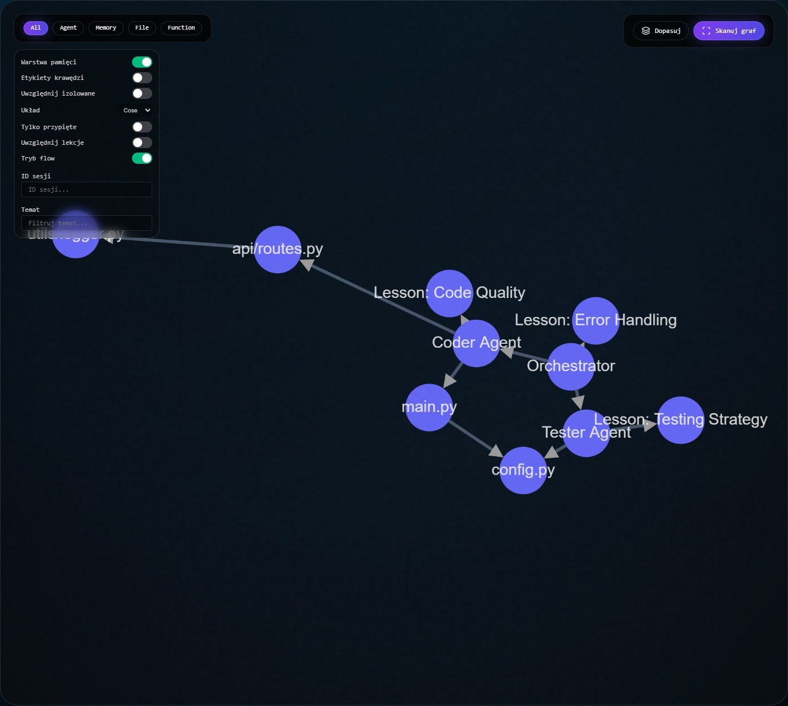
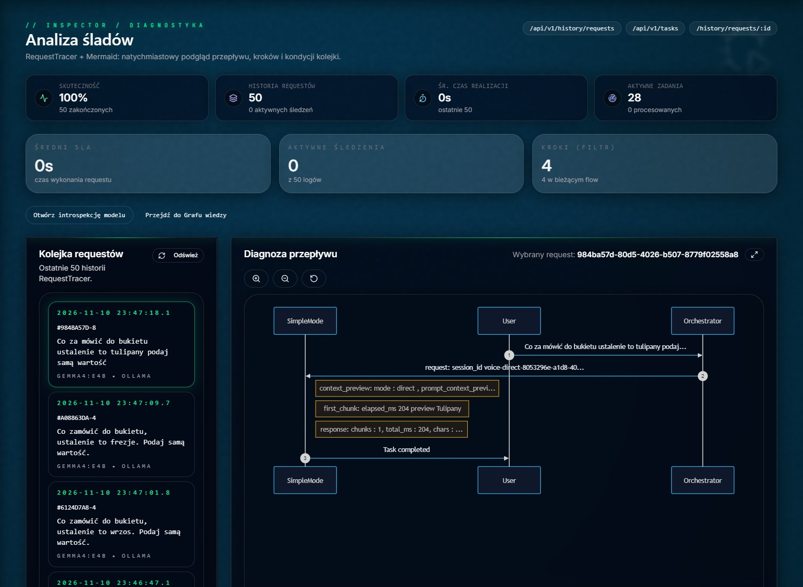
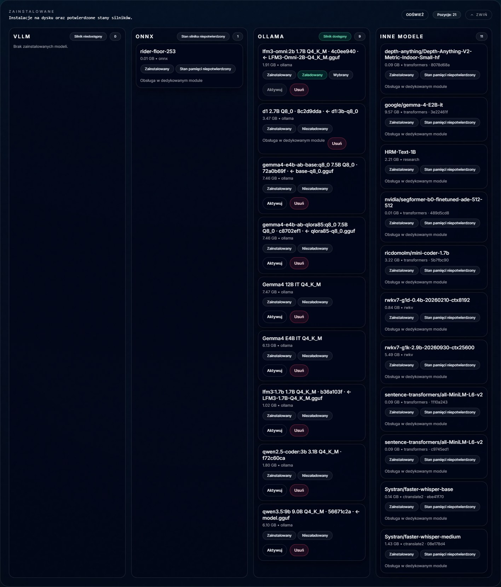

# Venom 1.10.0

[](https://www.gitguardian.com/)
[](https://github.com/mpieniak01/Venom/actions/workflows/ci.yml)
[](https://sonarcloud.io/summary/new_code?id=mpieniak01_Venom)
[](https://snyk.io/test/github/mpieniak01/Venom)

[Wersja polska](README_PL.md) · [Published releases](https://github.com/mpieniak01/Venom/releases)

**Venom** is an open-source AI platform for technical work, automation, and model experiments, designed for a single operator. It brings together text and voice conversations, document and image analysis, memory, and agents that use tools. Start with a question about a document, inspect a repository, trace how a task ran, and keep useful results for later work.

With local Ollama, the model and conversation data can stay on your machine. Full Venom provides tools, a knowledge graph, diagnostics, configuration, and learning experiments. In 1.10, **Studio** provides a separate Chat 2.0 app for everyday conversations, materials, and voice. Both variants share the selected environment's data.

The project also helps investigate which models are useful in practice. We compare answer quality, tool use, speech, memory use, and latency. The Gemma and Omni reports below document the results and the scope of each evaluation.

The `main` branch uses version **1.10.0**. Tagged downloads and release history are available under Published releases.

## What Venom provides

| Area | What it is for | Screen or guide |
| --- | --- | --- |
| Conversation and materials | Text, attached text files and images, voice, thread history, and stopping a response. Supported inputs depend on the selected model. | Studio `/chat2`, Full `/chat` and `/voice`. [Chat 2.0](docs/CHAT_2.md) |
| Agents and tools | Planning multi-step tasks, working with code and files, reviewing results, and diagnosing services within operator permissions. | Normal and Complex in Full. [Agent catalog](docs/SYSTEM_AGENTS_CATALOG.md) |
| Knowledge and memory | Explicit notes, RAG retrieval, lessons, and a graph of memory and code relationships. Follow connections between files, functions, and agent experience. | `/brain`. [Memory guide](docs/MEMORY_LAYER_GUIDE.md) |
| Inspector | Request history, flow diagrams, tool steps, and telemetry to inspect what the system executed. | `/inspector`. [Operator workflow](docs/CHAT_OPERATOR.md) |
| Workflows and configuration | Execution and service graphs, configuration plans, compatibility checks, applying changes, and restart requirements. | `/workflow-control` and `/config`. [Workflow Control](docs/THE_WORKFLOW_CONTROL.md) |
| Models and benchmarks | Model and provider catalogs, runtime selection, and quality and speed measurements. | `/models` and `/benchmark`. [Models and integrations](docs/INTEGRATIONS_OVERVIEW.md) |
| Model introspection | Inspect answers and available internal model signals alongside probe readiness. The scope depends on the runtime and configured probes. | `/inspector/model-introspection`. [Guide](docs/MODEL_INTROSPECTION_GUIDE.md) |
| Academy and learning | Data conversion, dataset preparation, training run and adapter management, and self-learning workflows. Training requires a separately prepared environment and evaluation. | `/academy`. [Academy](docs/THE_ACADEMY.md) |
| Extensions and integrations | MCP tools, service integrations, and modules installed from separate repositories through manifests. Rider-Pi is one example of a local extension. | [Integrations](docs/EXTERNAL_INTEGRATIONS.md) · [Optional modules](docs/MODULES_OPTIONAL_REGISTRY.md) |

In agent workflows, Architect breaks down the task, Researcher gathers information, Coder prepares code, Critic reviews it, and Librarian works with files. The repository also includes Ghost for GUI automation and Apprentice for recording demonstrations. These functions depend on enabled components, permissions, and available tools. [Agent roles](docs/SYSTEM_AGENTS_CATALOG.md) · [GUI automation](docs/GHOST_AGENT.md) · [Learning from demonstrations](docs/THE_APPRENTICE.md)

## Explore the modules

These screenshots were captured on November 11, 2026 in a local Full 1.10 instance. They show stored data and test scenarios. Click an image to inspect it.

<table>
  <tr>
    <td width="50%" valign="top">
      <a href="docs/assets/venom-110-knowledge.jpeg"></a>
      <strong>Knowledge and dependencies</strong><br />
      The built-in demonstration graph shows relationships between agents, files, and lessons.
    </td>
    <td width="50%" valign="top">
      <a href="docs/assets/venom-110-inspector.jpeg"></a>
      <strong>Task execution</strong><br />
      A recorded E4B voice trial shows context, the first response chunk, and request completion. Status metrics describe execution. The report evaluates answer quality.
    </td>
  </tr>
</table>

<details>
<summary>View the test instance's model inventory</summary>

[](docs/assets/venom-110-models.jpeg)

**Model management** shows installed models, their capabilities, and status. The inventory in this screenshot belongs to the test instance.

</details>

## Choose an application

| | Venom Studio | Venom Full |
| --- | --- | --- |
| Where to start | Chat 2.0 at `/chat2` | Chat at `/chat`, voice at `/voice` |
| What it runs | A dedicated web app and a subset of the shared API for chat, materials, voice, and model selection | The full web app and API with agent workflows, tools, configuration, and diagnostics |
| Chat modes | Direct and Normal | Direct, Normal, and Complex |

**Direct** sends the current conversation to the selected model. **Normal** adds routing, and **Complex** uses the full agent workflow for multi-step work. In Chat 2.0, enable **Use notes** in Normal for the current question or use **Save as note** on a selected answer. Conversation history is saved separately. Both applications share server-side data when run in the same environment. [Chat operator guide](docs/CHAT_OPERATOR.md) · [Studio runtime](docs/STUDIO.md)

Agent orchestration uses Microsoft Agent Framework. The quick start uses local Ollama. Direct text chat can also use [OpenRouter](docs/OPENROUTER_LOCAL_MVP.md) or [Ollama on Vast](docs/PL/VAST_START_I_ODZYSKIWANIE.md).

## Quick start on Linux or WSL2

Use Linux x86-64 with **Python 3.14.8**, **Node.js 24.22.0** and **npm 11.19.1**. Install these tools and start Ollama before running the quick start. The [deployment guide](docs/DEPLOYMENT_NEXT.md) covers native build dependencies, audio and installed launchers.

```bash
git clone https://github.com/mpieniak01/Venom.git
cd Venom
python3.14 scripts/bootstrap_dependency_profile.py --profile full --venv "$PWD/.venv"
npm --prefix web-next ci
make ensure-env-file ENVIRONMENT=dev
ollama pull gemma4:e4b
```

Set the following values in `.env.dev` for Ollama on the same Linux host.

```dotenv
ACTIVE_LLM_SERVER=ollama
LLM_SERVICE_TYPE=local
LLM_LOCAL_ENDPOINT=http://127.0.0.1:11434/v1
LLM_MODEL_NAME=gemma4:e4b
```

Start **Studio** and open `/chat2` at the UI address printed by the launcher. With repository defaults it is [http://localhost:3000/chat2](http://localhost:3000/chat2).

```bash
make start-studio PROFILE=full ENVIRONMENT=dev
make status-studio PROFILE=full ENVIRONMENT=dev
```

Stop Studio before starting **Venom Full**. Open [chat](http://localhost:3000/chat) or [voice](http://localhost:3000/voice) using the address printed by the launcher.

```bash
make stop-studio PROFILE=full ENVIRONMENT=dev
make start-venom PROFILE=full ENVIRONMENT=dev
make status-venom PROFILE=full ENVIRONMENT=dev
```

```bash
make stop-venom PROFILE=full ENVIRONMENT=dev
```

The examples use the Full dependency set so audio can be configured later. Application choice, the Full/Light runtime profile, and the dev/preprod environment are independent. Use `dev` for local operation and `preprod` for isolated, read-only verification. [Stack profiles](docs/STACK_PROFILES.md) · [Dependency profiles](docs/DEPENDENCY_PROFILES.md)

## Architecture and development

Venom 1.10 uses FastAPI, Next.js, and Microsoft Agent Framework. Studio has its own frontend and a subset of the shared API. Conversation logic, provider contracts, and environment data are shared. Direct sends the response through the selected model adapter. Agent workflows use orchestration and tools. [Backend architecture](docs/BACKEND_ARCHITECTURE.md) · [MAF contract](docs/MAF_RUNTIME_CONTRACT.md)

```text
venom_core/
  api/                 API, contracts, and access control
  core/flows/          Task flows and orchestration
  agents/              Specialized agent roles
  execution/           Model providers, MAF, and tools
  memory/              Notes, vector memory, graphs, and lessons
  learning/            Data preparation and learning workflows
  perception/          Audio and perception
web-next/              Full Venom interface
web-studio/            Separate Chat 2.0 app
modules/               Locally installed modules from separate repositories
```

Available features depend on the installed dependency set. Ollama runs as a separate service, and the CUDA daemon has its own environment. Academy training and additional model engines require separate qualification. [Dependency profiles and deployment status](docs/DEPENDENCY_PROFILES.md)

## Polish multimodal benchmark

We compared baseline **Gemma 4 E4B** and **LFM3-Omni-2B** on the frozen `pl-assistant-v1` suite. Each profile ran 200 scenarios with reference text and 80 additional runs with recordings. Both used Q4_K_M packages with Ollama 0.40.14 on the same RTX 3060 with 12 GiB of VRAM under WSL2. The Gemma profile used Whisper and Piper for this run. Omni used its native speech recognition and synthesis.

| Measurement | `gemma4:e4b` | `lfm3-omni:2b` |
| --- | ---: | ---: |
| Strict passes | **254/280 (90.71%)** | 209/280 (74.64%) |
| Peak GPU memory across the device | 9,741 MiB | **7,962 MiB** |
| Median time to ready WAV on eight recorded instructions | 0.951 s | **0.511 s** |

Gemma led on strict accuracy. Omni used less GPU memory and returned the WAV sooner in this run. The report also gives browser playback timings, per-task scores, and a separate Full acceptance run after changes to Gemma's native speech recognition. [English report](docs/EN/POLISH_MULTIMODAL_ASSISTANT_EXPERIMENT.md) · [Polish report](docs/PL/POLISH_MULTIMODAL_ASSISTANT_EXPERIMENT.md)

## Documentation

- **Start and operate** · [Deployment](docs/DEPLOYMENT_NEXT.md) · [Studio](docs/STUDIO.md) · [Full/Light profiles](docs/STACK_PROFILES.md) · [Environments](docs/ENVIRONMENTS_SUPPORT.md) · [Docker](docs/DOCKER_RELEASE_GUIDE.md)
- **Work with Venom** · [Dashboard](docs/DASHBOARD_GUIDE.md) · [Chat operator](docs/CHAT_OPERATOR.md) · [Tools](docs/TOOLS_USAGE_GUIDE.md) · [Memory](docs/MEMORY_LAYER_GUIDE.md) · [Configuration](docs/CONFIG_PANEL.md)
- **Agents and extensions** · [Agent catalog](docs/SYSTEM_AGENTS_CATALOG.md) · [Researcher](docs/THE_RESEARCHER.md) · [Building tools](docs/THE_FORGE.md) · [Integrations](docs/EXTERNAL_INTEGRATIONS.md) · [Optional modules](docs/MODULES_OPTIONAL_REGISTRY.md)
- **Models and experiments** · [Academy](docs/THE_ACADEMY.md) · [Training data catalog](docs/TRAINING_DATA_CATALOG.md) · [E4B pilot](docs/PL/GEMMA4_E4B_PILOT.md) · [LFM3 evaluation](docs/PL/LFM3_LOCAL_EVALUATION.md) · [Polish assistant benchmark](docs/PL/POLSKI_BENCHMARK_ASYSTENTA.md)
- **Providers** · [OpenRouter](docs/OPENROUTER_LOCAL_MVP.md) · [Vast and Ollama](docs/PL/VAST_START_I_ODZYSKIWANIE.md)
- **Development and quality** · [Backend](docs/BACKEND_ARCHITECTURE.md) · [Frontend](docs/FRONTEND_NEXT_GUIDE.md) · [Contributing](docs/CONTRIBUTING.md) · [Testing policy](docs/TESTING_POLICY.md) · [GitHub Actions](https://github.com/mpieniak01/Venom/actions)

## License and contributors

Venom is distributed under the [MIT license](LICENSE). Copyright © 2025–2026 Maciej Pieniak. [Contributors](https://github.com/mpieniak01/Venom/graphs/contributors)
