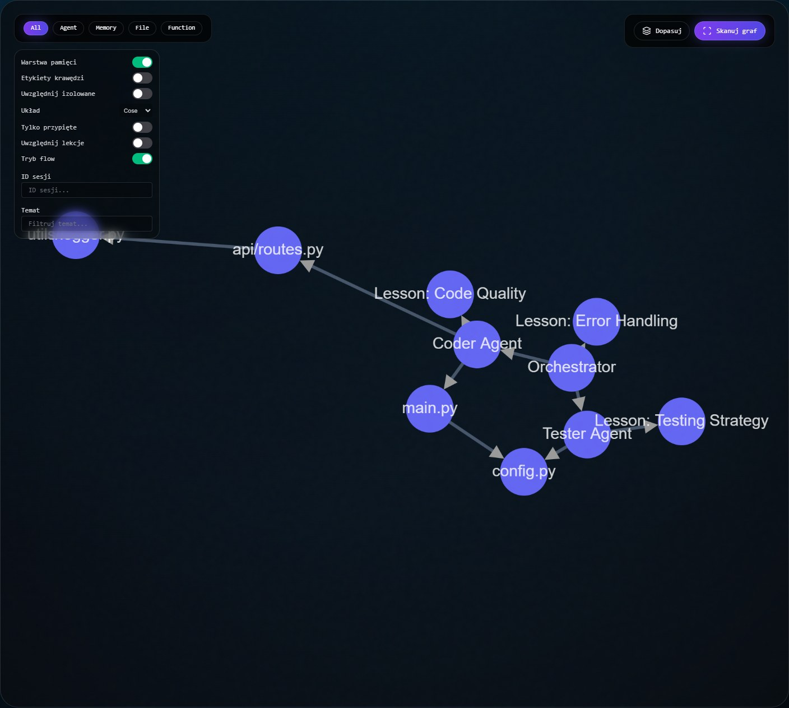
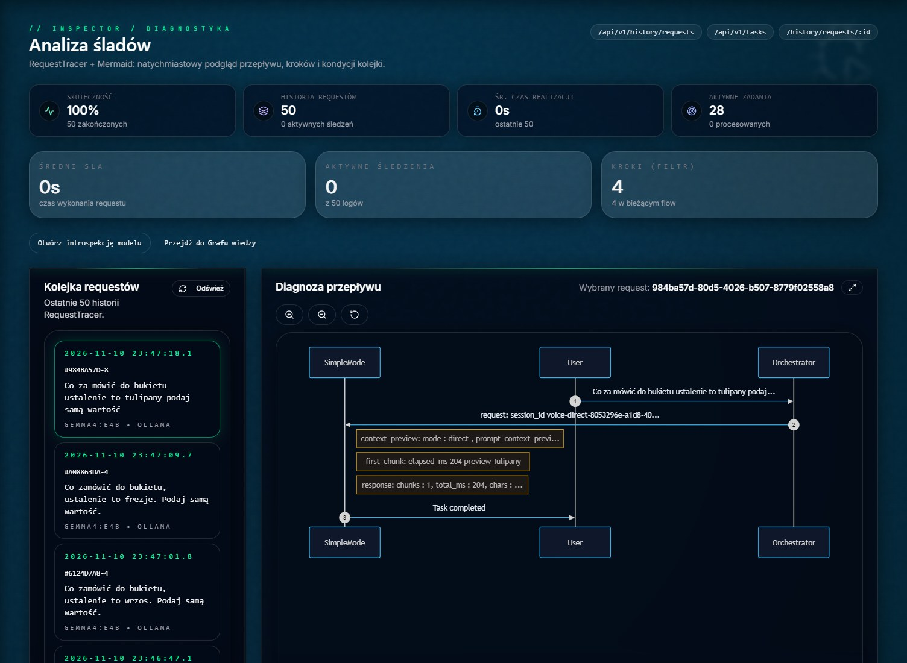
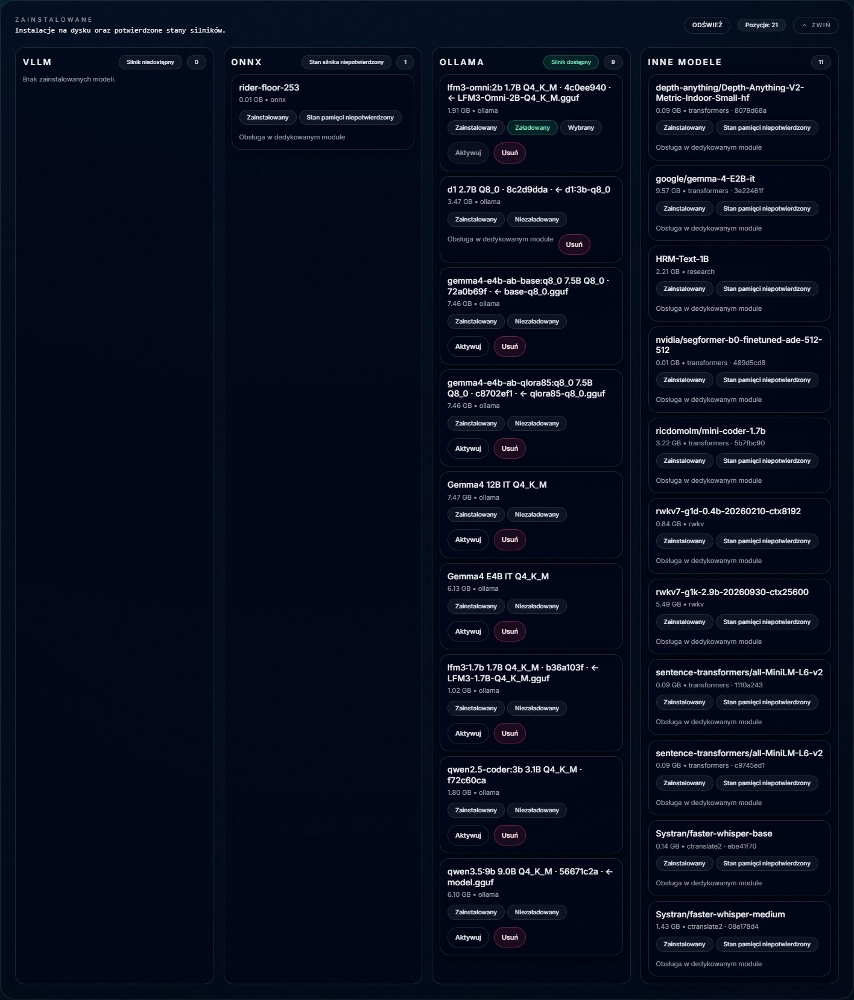

# Venom 1.10.0

[](https://www.gitguardian.com/)
[](https://github.com/mpieniak01/Venom/actions/workflows/ci.yml)
[](https://sonarcloud.io/summary/new_code?id=mpieniak01_Venom)
[](https://snyk.io/test/github/mpieniak01/Venom)

[English version](README.md) · [Opublikowane wydania](https://github.com/mpieniak01/Venom/releases)

**Venom** to otwarta platforma AI do pracy technicznej, automatyzacji i eksperymentów z modelami, rozwijana z myślą o jednym operatorze. Łączy rozmowę tekstową i głosową, analizę materiałów, pamięć oraz agentów wykonujących zadania przez narzędzia. Możesz przejść od pytania o dokument do analizy repozytorium, sprawdzić przebieg zadania i zachować przydatne wyniki do dalszej pracy.

Przy lokalnej Ollamie model i dane rozmowy mogą pozostać na własnym komputerze. Pełny Venom daje dostęp do narzędzi, grafu wiedzy, diagnostyki, konfiguracji i eksperymentów z uczeniem. W wersji 1.10 **Studio** udostępnia osobny interfejs Chat 2.0 do codziennej rozmowy, materiałów i głosu. Oba warianty współdzielą dane wybranego środowiska.

Projekt pozwala także badać, który model rzeczywiście pomaga w pracy. Porównujemy jakość odpowiedzi, poprawność użycia narzędzi, mowę, zużycie pamięci i opóźnienia. Wyniki Gemmy i Omni oraz zakres ich kwalifikacji opisujemy w raportach dostępnych niżej.

Gałąź `main` używa wersji **1.10.0**. Paczki oznaczone tagami i historia wydań są dostępne w opublikowanych wydaniach.

## Możliwości Venoma

| Obszar | Do czego służy | Ekran lub przewodnik |
| --- | --- | --- |
| Rozmowa i materiały | Tekst, załączone pliki tekstowe i obrazy, głos, historia wątku i zatrzymanie odpowiedzi. Możliwości wejścia zależą od wybranego modelu. | Studio `/chat2`, Full `/chat` i `/voice`. [Chat 2.0](docs/PL/CHAT_2.md) |
| Agenci i narzędzia | Planowanie wieloetapowych zadań, praca z kodem i plikami, przegląd wyników oraz diagnostyka usług zgodnie z uprawnieniami operatora. | Tryby Normal i Complex w Full. [Katalog agentów](docs/PL/SYSTEM_AGENTS_CATALOG.md) |
| Wiedza i pamięć | Notatki na żądanie, wyszukiwanie RAG, lekcje oraz graf powiązań pamięci i kodu. Można prześledzić relacje plików, funkcji i doświadczeń agentów. | `/brain`. [Warstwa pamięci](docs/PL/MEMORY_LAYER_GUIDE.md) |
| Inspektor | Historia żądań, diagram przebiegu, kroki narzędzi i telemetria pomagające ustalić, co wykonał system. | `/inspector`. [Workflow operatora](docs/PL/CHAT_OPERATOR.md) |
| Przepływy i konfiguracja | Graf wykonania i usług, plan zmian konfiguracji, kontrola zgodności, zastosowanie zmian i informacja o wymaganym restarcie. | `/workflow-control` i `/config`. [Workflow Control](docs/PL/THE_WORKFLOW_CONTROL.md) |
| Modele i benchmarki | Katalog modeli i dostawców, wybór środowiska wykonawczego oraz pomiary jakości i szybkości. | `/models` i `/benchmark`. [Modele i integracje](docs/PL/INTEGRATIONS_OVERVIEW.md) |
| Introspekcja modelu | Analiza odpowiedzi i dostępnych sygnałów wewnętrznych modelu wraz ze stanem gotowości sond. Zakres zależy od silnika i konfiguracji sond. | `/inspector/model-introspection`. [Przewodnik](docs/PL/MODEL_INTROSPECTION_GUIDE.md) |
| Akademia i uczenie | Konwersja danych, przygotowanie datasetów, obsługa przebiegów treningowych, adapterów i samokształcenia. Trening wymaga osobnego, przygotowanego środowiska i oceny wyników. | `/academy`. [Akademia](docs/PL/THE_ACADEMY.md) |
| Rozszerzenia i integracje | Narzędzia MCP, integracje usług oraz moduły instalowane z osobnych repozytoriów przez manifest. Przykładem lokalnego rozszerzenia jest Rider-Pi. | [Integracje](docs/PL/EXTERNAL_INTEGRATIONS.md) · [Moduły opcjonalne](docs/PL/MODULES_OPTIONAL_REGISTRY.md) |

W pracy agentowej Architect rozbija zadanie na kroki, Researcher zbiera informacje, Coder przygotowuje kod, Critic go ocenia, a Librarian operuje na plikach. Repozytorium zawiera również Ghost do automatyzacji interfejsu i Apprentice do rejestrowania demonstracji. Uruchomienie tych funkcji zależy od włączonych komponentów, uprawnień i dostępnych narzędzi. [Role agentów](docs/PL/SYSTEM_AGENTS_CATALOG.md) · [Automatyzacja GUI](docs/PL/GHOST_AGENT.md) · [Uczenie przez demonstrację](docs/PL/THE_APPRENTICE.md)

## Podgląd modułów

Zrzuty wykonano 11 listopada 2026 w lokalnej instancji Full 1.10. Pokazują zapisane dane i scenariusze testowe. Kliknij obraz, aby obejrzeć szczegóły.

<table>
  <tr>
    <td width="50%" valign="top">
      <a href="docs/assets/venom-110-knowledge.jpeg"></a>
      <strong>Wiedza i zależności</strong><br />
      Wbudowane dane demonstracyjne grafu pokazują relacje agentów, plików i lekcji.
    </td>
    <td width="50%" valign="top">
      <a href="docs/assets/venom-110-inspector.jpeg"></a>
      <strong>Przebieg zadania</strong><br />
      Zapisana próba głosowa E4B z kontekstem, pierwszym fragmentem odpowiedzi i zakończeniem żądania. Statusy dotyczą wykonania, a ocenę jakości opisuje raport.
    </td>
  </tr>
</table>

<details>
<summary>Zobacz katalog modeli z instancji testowej</summary>

[](docs/assets/venom-110-models.jpeg)

**Zarządzanie modelami** pokazuje faktycznie zainstalowane modele, ich możliwości i stan. Zestaw na zrzucie pochodzi z instancji testowej.

</details>

## Wybór aplikacji

| | Venom Studio | Venom Full |
| --- | --- | --- |
| Gdzie zacząć | Chat 2.0 pod `/chat2` | Czat pod `/chat`, głos pod `/voice` |
| Co uruchamia | Osobny frontend i podzbiór wspólnego API do czatu, materiałów, głosu i wyboru modelu | Pełny frontend i API z obsługą agentów, narzędzi, konfiguracji i diagnostyki |
| Tryby czatu | Direct i Normal | Direct, Normal i Complex |

**Direct** przekazuje bieżącą rozmowę do wybranego modelu. **Normal** dodaje routing, a **Complex** obsługuje wieloetapową pracę agentów. W Chat 2.0 możesz włączyć **Użyj notatek** dla bieżącego pytania w Normal lub użyć **Zapisz jako notatkę** przy wybranej odpowiedzi. Historia rozmowy zapisuje się osobno. Obie aplikacje współdzielą dane po stronie serwera w tym samym środowisku. [Instrukcja operatora czatu](docs/PL/CHAT_OPERATOR.md) · [Uruchamianie Studio](docs/PL/STUDIO.md)

Orkiestracja agentów korzysta z Microsoft Agent Framework. Szybki start używa lokalnej Ollamy. Czat tekstowy w Direct może też korzystać z [OpenRoutera](docs/OPENROUTER_LOCAL_MVP.md) lub [Ollamy na Vast](docs/PL/VAST_START_I_ODZYSKIWANIE.md).

## Szybki start w Linuksie lub WSL2

Potrzebujesz Linuksa x86-64, **Pythona 3.14.8**, **Node.js 24.22.0**, **npm 11.19.1** oraz działającej usługi Ollama. [Przewodnik wdrożeniowy](docs/PL/DEPLOYMENT_NEXT.md) opisuje zależności systemowe, uruchamianie głosu i obsługę zainstalowanej instancji.

```bash
git clone https://github.com/mpieniak01/Venom.git
cd Venom
python3.14 scripts/bootstrap_dependency_profile.py --profile full --venv "$PWD/.venv"
npm --prefix web-next ci
make ensure-env-file ENVIRONMENT=dev
ollama pull gemma4:e4b
```

Ustaw poniższe wartości w `.env.dev` dla Ollamy działającej na tym samym hoście z Linuksem.

```dotenv
ACTIVE_LLM_SERVER=ollama
LLM_SERVICE_TYPE=local
LLM_LOCAL_ENDPOINT=http://127.0.0.1:11434/v1
LLM_MODEL_NAME=gemma4:e4b
```

Uruchom **Studio** i otwórz `/chat2` pod adresem interfejsu wypisanym przez launcher. Domyślna konfiguracja repozytorium używa [http://localhost:3000/chat2](http://localhost:3000/chat2).

```bash
make start-studio PROFILE=full ENVIRONMENT=dev
make status-studio PROFILE=full ENVIRONMENT=dev
```

Aby uruchomić **Venom Full**, najpierw zatrzymaj Studio. Otwórz [czat](http://localhost:3000/chat) lub [głos](http://localhost:3000/voice) pod adresem wskazanym przez launcher.

```bash
make stop-studio PROFILE=full ENVIRONMENT=dev
make start-venom PROFILE=full ENVIRONMENT=dev
make status-venom PROFILE=full ENVIRONMENT=dev
```

```bash
make stop-venom PROFILE=full ENVIRONMENT=dev
```

Przykłady korzystają z pełnego zestawu zależności, żeby można było później skonfigurować głos. Wariant aplikacji, profil uruchomieniowy Full/Light i środowisko dev/preprod to trzy osobne wybory. Do pracy lokalnej służy `dev`, a do odizolowanej weryfikacji tylko do odczytu `preprod`. [Profile stosu](docs/PL/STACK_PROFILES.md) · [Profile zależności](docs/DEPENDENCY_PROFILES.md)

## Architektura i rozwój

Venom 1.10 korzysta z FastAPI, Next.js i Microsoft Agent Framework. Studio ma własny frontend i podzbiór współdzielonego API. Logika rozmów, kontrakty dostawców i dane środowiska są wspólne. W Direct odpowiedź trafia przez adapter wybranego modelu, a przepływy agentowe korzystają z orkiestracji i narzędzi. [Architektura backendu](docs/PL/BACKEND_ARCHITECTURE.md) · [Kontrakt MAF](docs/MAF_RUNTIME_CONTRACT.md)

```text
venom_core/
  api/                 API, kontrakty i kontrola dostępu
  core/flows/          Przepływy zadań i orkiestracja
  agents/              Wyspecjalizowane role agentów
  execution/           Dostawcy modeli, MAF i narzędzia
  memory/              Notatki, pamięć wektorowa, graf i lekcje
  learning/            Przygotowanie danych i procesy uczenia
  perception/          Audio i percepcja
web-next/              Pełny interfejs Venoma
web-studio/            Osobna aplikacja Chat 2.0
modules/               Lokalnie instalowane moduły z osobnych repozytoriów
```

Pełny zakres aplikacji zależy od zainstalowanego zestawu zależności. Ollama działa jako osobna usługa, a daemon CUDA ma własne środowisko. Treningi Akademii i dodatkowe silniki wymagają odrębnej kwalifikacji. [Profile zależności i stan wdrożenia](docs/DEPENDENCY_PROFILES.md)

## Ocena modeli multimodalnych

Academy i tor głosowy mają osobne ścieżki kwalifikacji tekstu, audio, obrazu
oraz narzędzi. Lokalne zbiory, wyniki pomiarów i raporty konkretnego hosta
przechowujemy poza dokumentacją publikowaną z repozytorium.

## Dokumentacja

- **Uruchomienie i obsługa** · [Wdrożenie](docs/PL/DEPLOYMENT_NEXT.md) · [Studio](docs/PL/STUDIO.md) · [Profile Full/Light](docs/PL/STACK_PROFILES.md) · [Środowiska](docs/PL/ENVIRONMENTS_SUPPORT.md) · [Docker](docs/PL/DOCKER_RELEASE_GUIDE.md)
- **Praca z Venomem** · [Kokpit](docs/PL/DASHBOARD_GUIDE.md) · [Operator czatu](docs/PL/CHAT_OPERATOR.md) · [Narzędzia](docs/PL/TOOLS_USAGE_GUIDE.md) · [Pamięć](docs/PL/MEMORY_LAYER_GUIDE.md) · [Konfiguracja](docs/PL/CONFIG_PANEL.md)
- **Agenci i rozszerzenia** · [Katalog agentów](docs/PL/SYSTEM_AGENTS_CATALOG.md) · [Researcher](docs/PL/THE_RESEARCHER.md) · [Tworzenie narzędzi](docs/PL/THE_FORGE.md) · [Integracje](docs/PL/EXTERNAL_INTEGRATIONS.md) · [Moduły opcjonalne](docs/PL/MODULES_OPTIONAL_REGISTRY.md)
- **Modele i eksperymenty** · [Akademia](docs/PL/THE_ACADEMY.md) · [Dostrajanie modeli](docs/PL/MODEL_TUNING_GUIDE.md) · [Tor głosowy](docs/PL/VOICE_RUNTIME_CAPABILITIES.md)
- **Dostawcy** · [OpenRouter](docs/OPENROUTER_LOCAL_MVP.md) · [Vast i Ollama](docs/PL/VAST_START_I_ODZYSKIWANIE.md)
- **Rozwój i jakość** · [Backend](docs/PL/BACKEND_ARCHITECTURE.md) · [Frontend](docs/PL/FRONTEND_NEXT_GUIDE.md) · [Współtworzenie](docs/PL/CONTRIBUTING.md) · [Polityka testów](docs/PL/TESTING_POLICY.md) · [GitHub Actions](https://github.com/mpieniak01/Venom/actions)

## Licencja i współtwórcy

Venom jest udostępniany na [licencji MIT](LICENSE). Copyright © 2025–2026 Maciej Pieniak. [Współtwórcy](https://github.com/mpieniak01/Venom/graphs/contributors)
